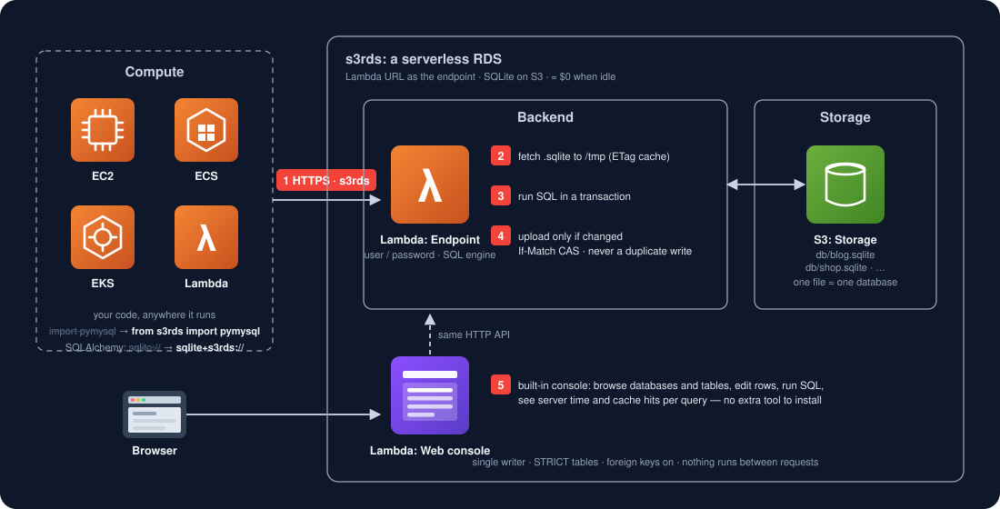

# s3rds

**A truly serverless RDS: a Lambda URL is your database endpoint, SQLite on S3 is your storage, ≈ $0 when idle.**

[中文说明](README.zh.md) · Part of *Redefine Serverless* — AWS primitives that cost ≈ $0 when idle.



> Design principle: this is a relational database, so correctness comes first — atomicity and
> consistency are not negotiable. A write may fail, but it never duplicates and never corrupts.
> The upside is cost (≈ $0 idle); the trade-off is performance. Order of priorities: correctness > cost > performance.

## Why

"Serverless" on AWS usually means *the box scales*. It rarely means *there is no box*.

| Option | Idle cost / month (us-east-2, approx.) |
|---|---|
| **s3rds** | **≈ $0** — S3 storage only; a 20 MB database ≈ $0.0005 |
| RDS MySQL `db.t4g.micro` (cheapest provisioned) | ~$14 (instance + 20 GB gp3; free tier for 12 months only) |
| RDS MySQL `db.t4g.medium` | ~$50 |
| Aurora Serverless v2 (0.5 ACU floor) | ~$45 (storage billed even when paused) |

s3rds has no instance. Nothing runs between requests. Lambda stays inside the permanent
free tier (1M requests + 400k GB-s per month); beyond that it is $0.20 per million requests.

## How it works

- **One database = one `.sqlite` file on S3.** The db lambda downloads it to `/tmp`, runs your SQL, and
  uploads the whole file back only if the data actually changed (SQLite's authorizer + a file fingerprint decide).
- **Reads are cheap**: an ETag check against a warm `/tmp` copy, ~15 ms server-side, no download.
- **Writes are safe**: every statement runs in an explicit transaction (DDL included); the upload is a
  conditional `If-Match` PUT (compare-and-swap). A conflict re-downloads and replays; exhausted retries fail
  cleanly and invalidate the local copy. No phantom data, ever.
- **Single writer** by construction (`reserved_concurrency = 1`), plus a separate **read-only endpoint**
  with unlimited concurrency (same code, `READONLY=1`).

Mapped to RDS concepts:

| RDS | s3rds |
|---|---|
| DB instance endpoint | the db lambda's Function URL |
| a database on the instance | one `.sqlite` object in the bucket |
| `database=` in the connection string | `/api/db/{name}` in the URL |
| user / password | HTTP Basic (`db_user` / `db_password`) |
| data directory | `s3://<bucket>/db/` |
| `CREATE DATABASE` | `POST /api/databases` |

## Quick start

### 1. Deploy the server (pick one)

**Terraform**

```bash
cp terraform/example.json terraform/my.json      # set aws_profile, env, db_password, auth_token
cd terraform
terraform init
terraform apply -var-file=my.json
terraform output                                  # db_url, db_ro_url, demo_url
```

**CloudFormation** (AWS CLI only)

```bash
cp cloudformation/example-params.json cloudformation/params.json   # set passwords
cp client/sqlite.py src/demo/                                   # demo bundles the driver
aws cloudformation package --template-file cloudformation/template.yaml \
    --s3-bucket <any-bucket-you-own> --output-template-file /tmp/s3rds.yaml
aws cloudformation deploy --template-file /tmp/s3rds.yaml --stack-name s3rds \
    --capabilities CAPABILITY_IAM --parameter-overrides file://cloudformation/params.json
```

Both create the same thing: an S3 bucket (`<env>-srds-db-2026`), three Lambdas (read/write, read-only, demo)
with public Function URLs, and one scoped IAM role. The bucket name is global on S3 — if it is taken, change the suffix.

### 2. Open the console

Open `db_url` in a browser, sign in with `db_user` / `db_password`. Create a database, create a table
(STRICT by default), add columns, edit rows, run SQL. Every operation shows server time and whether it hit the
`/tmp` cache or went to S3.

### 3. Connect from code

```bash
pip install s3rds              # pys3sqlite: SQLite dialect, zero dependencies
pip install "s3rds[mysql]"     # + pys3mysql: write MySQL, translated on the client (sqlglot)
```

Pick the dialect you want to write; the API is pymysql-shaped either way, and `import pymysql`
on a real RDS is the final one-line switch:

```python
from s3rds import sqlite                            # SQLite dialect
# from s3rds import pymysql                         # MySQL dialect (see "MySQL dialect" below)

conn = sqlite.connect(host="xxxx.lambda-url.us-east-2.on.aws",
                         user="admin", password="...", database="blog")

with conn.cursor() as cur:
    cur.execute("INSERT INTO posts (title) VALUES (%s)", ["hello"])
    print(cur.lastrowid)

with conn.cursor(sqlite.cursors.DictCursor) as cur:
    cur.execute("SELECT * FROM posts WHERE id = %s", [1])
    print(cur.fetchall())

conn.transaction([                                   # all-or-nothing, one S3 write
    ("UPDATE stock SET qty = qty - 1 WHERE id = %s", [7]),
    ("INSERT INTO orders (item) VALUES (%s)", [7]),
])
```

Zero dependencies (standard library only). The wire protocol is plain HTTPS + JSON, so any language works:

```bash
curl -s -u "admin:password" -H "content-type: application/json" \
     -d '{"sql":"SELECT * FROM posts WHERE id = ?","params":[1]}' \
     "https://xxxx.lambda-url.us-east-2.on.aws/api/db/blog/query"
```

## Guarantees

| | How |
|---|---|
| **Atomicity** | explicit `BEGIN/COMMIT` per request (DDL included) + atomic S3 PUT; `/tx` runs several statements as one |
| **Consistency** | SQLite constraints; `STRICT` tables by default; `PRAGMA foreign_keys=ON` on every write connection |
| **Isolation** | one writer (reserved concurrency 1 + `If-Match` CAS); readers see a whole-file snapshot |
| **Durability** | the client gets OK only after the S3 PUT succeeds (11 nines) |
| **No duplicate writes** | the driver re-sends only when the request provably never reached the server; timeouts raise "result unknown" |

All of this is pinned by tests against an in-memory S3 that implements ETag / `If-Match` / `If-None-Match` semantics:

```bash
pip install pytest boto3
pytest tests/ -v
```

## MySQL dialect (`s3rds.pymysql`)

Write MySQL, run on the same endpoint. Statements are translated on the client (sqlglot, cached per statement):

- `%s` / `%(name)s` placeholders, backticks, `LIMIT offset, count`
- `AUTO_INCREMENT` → `INTEGER PRIMARY KEY AUTOINCREMENT`; `ENUM(...)` → `TEXT CHECK (...)`;
  text columns get `COLLATE NOCASE` (MySQL's case-insensitive default)
- `INSERT IGNORE`, `ON DUPLICATE KEY UPDATE` (`VALUES(col)` → `excluded.col`), `LAST_INSERT_ID()`
- `SHOW TABLES / DATABASES / COLUMNS / CREATE TABLE / INDEX`, `DESCRIBE`, `SELECT VERSION()`, `SELECT DATABASE()`
- errors are pymysql-style classes with MySQL codes: 1062 duplicate, 1146 no table, 1054 no column, 1064 syntax, …
- `ENGINE=`, `CHARSET=`, `ON UPDATE CURRENT_TIMESTAMP` and inline `KEY`/`INDEX` are dropped

Not supported — raises `NotSupportedError`, never silently wrong: stored procedures/functions, triggers,
`FULLTEXT`, `SELECT … FOR UPDATE`, `LOCK TABLES`, `GRANT`/users. Result values come back as stored
(no `DATETIME` → `datetime` conversion yet).

`tests/test_pys3mysql.py` runs the dialect end-to-end against the real server code; set `MYSQL_DSN` to also
compare every statement with a real MySQL.

## Where it fits

| Database size | Verdict |
|---|---|
| **< 10 MB** | sweet spot — warm reads 20–50 ms, cold read / write ~300 ms |
| **10–20 MB** | design limit — writes a few hundred ms, still smooth |
| **20–50 MB** | works, but each write re-uploads the file (~1 s); frequent writes get annoying |
| **> 50 MB** | move to a real RDS — see [MIGRATION.md](MIGRATION.md) |

Reads do not degrade with size (ETag cache); only cold reads and writes move the whole file.
Write throughput is a few per second. Good for personal apps, internal tools, blogs, MVPs; not for high-concurrency OLTP.

`scripts/bench.py` measures end-to-end latency and throughput against your deployment and cleans up after itself.

## Repository layout

```
src/db/           the database: lambda_function.py (HTTP API), s3_sqlite.py (engine), index.html (console)
src/demo/         a sample business Lambda that uses the endpoint like an RDS
client/           the pip package s3rds: s3rds/sqlite.py, s3rds/pymysql.py, s3rds/psycopg2.py, pyproject.toml
terraform/        deployment, option A
cloudformation/   deployment, option B
tests/            correctness guarantees
scripts/          bench.py
MIGRATION.md      how to move to RDS MySQL when you outgrow this
```

## Roadmap

- `s3rds.pymysql`: `DATETIME`/`DECIMAL` result conversion, more MySQL functions, a published compatibility report.
- `s3rds.psycopg2`: PostgreSQL dialect (placeholder module ships today; `connect()` raises until implemented).
- One-click CloudFormation *Launch Stack* button.

## The Redefine Serverless series

AWS "serverless" services that still bill while idle, rebuilt on primitives that cost ≈ $0 when idle.
Same rule everywhere: project = pip = import name; each submodule is named after the standard client
it mirrors, so going back to the real service is one import line.

| Replaces | Idle floor / month | Built on | Project | Usage | Status |
|---|---|---|---|---|---|
| RDS / Aurora Serverless | ~$14–45 | S3 + Lambda | **s3rds** | `from s3rds import pymysql` · `sqlite` · `psycopg2` | this repo |
| Redis / ElastiCache Serverless | ~$90 | DynamoDB | **pyredis** | `from pyredis import redis` | next |
| Airflow / MWAA | ~$360 | Lambda + EventBridge + Step Functions | **lambdaflow** | `from lambdaflow import airflow` | planned |
| Redshift Serverless | ~$3/h once it wakes | S3 + DuckDB | **s3shift** | `from s3shift import redshift_connector` | planned |
| OpenSearch Serverless | ~$350 | S3 + SQLite FTS5 (on s3rds) | **s3search** | `from s3search import opensearchpy` | planned |
| Kafka / MSK Serverless | ~$550 | SQS | **sqskafka** | `from sqskafka import kafka` | planned |
| DocumentDB (MongoDB) | ~$200 | SQLite JSON1 (on s3rds) | **s3mongo** | `from s3mongo import pymongo` | planned |
| Amazon MQ (RabbitMQ) | ~$20–50 | SQS | **sqsmq** | `from sqsmq import pika` | planned |

Also covered by the above: MemoryDB (→ pyredis), Kinesis Data Streams (→ sqskafka), Timestream (→ s3shift).

Shared principles: ≈ $0 when idle, no container and no instance, drop-in standard interfaces,
one test suite run against the real service and the rebuild, MIT.

## License

MIT
